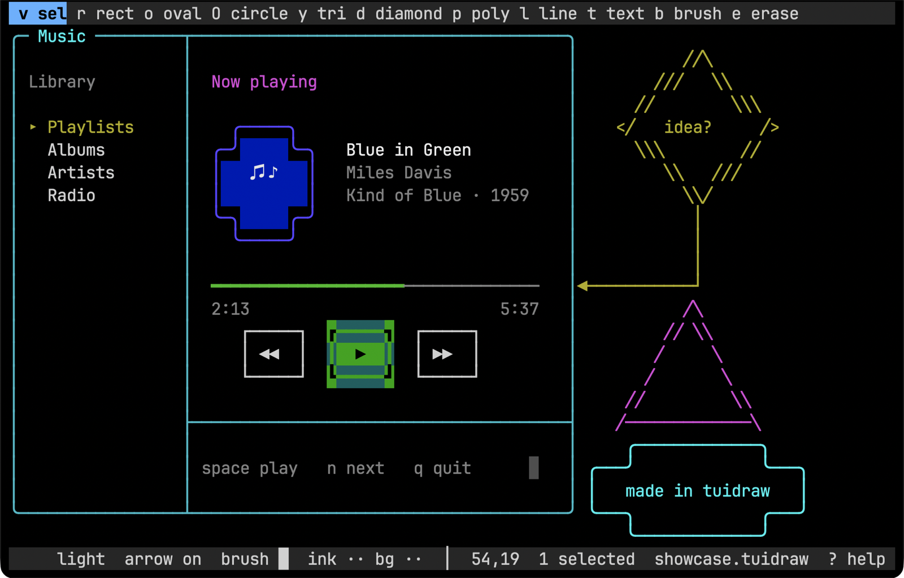

# tuidraw

An infinite-canvas editor for designing terminal UIs, and itself a terminal
app. Think Figma or Freeform, but every cell is one terminal character, so
what you draw is exactly what a TUI can show.



## Purpose

Sketch a terminal UI before you build it. General design tools like Figma
work in pixels, so a mockup never quite matches what a terminal can show.
ASCII editors like ASCIIFlow, Monodraw or Durdraw either stop at plain boxes
and lines, lack color, or are hard to use. tuidraw sits between them: a
lightweight, minimal canvas with sensible controls, where every shape lands
on the character grid, so the design you draw is the screen you will build.

## Features

- Infinite canvas: pan and scroll in any direction.
- Shapes: rect, oval, circle, triangle, diamond, polygon, line or arrow,
  text, brush.
- Borders join where they touch or cross (`┼ ├ ┬`), in five styles: light,
  heavy, double, rounded, ascii.
- Shapes stay editable: select, move, resize, restyle, group, reorder.
- 16 ANSI colors for ink and background, opaque fill, eraser.
- Undo and redo, copy and paste (to the system clipboard as text).
- Mouse and keyboard: Figma-style tool keys, plus a keyboard cursor that can
  do everything the mouse does.
- Lightweight: one Go binary, no runtime.

## Requirements

- Go 1.27.2 or newer to build.
- A terminal with mouse support, such as iTerm2, Terminal.app, kitty,
  WezTerm or Ghostty.

## Install

```bash
go install github.com/raveensrk/tuidraw/cmd/tuidraw@latest
```

Or from a clone, which runs the tests first:

```bash
./install.sh
```

It runs the tests, then installs `tuidraw` into `$(go env GOPATH)/bin`, and
warns when that folder is not on `PATH`. `./install.sh --help` lists its
options.

## Use

```bash
tuidraw login_screen.tuidraw
```

Run `tuidraw --help` for options. In the editor, press `?` for every key
binding.

## Files

| File | What |
|---|---|
| `<name>.tuidraw` | The project: JSON, shapes stay editable. Written by `ctrl+s`. |
| `<name>.txt` | Plain text export. Paste into docs or code comments. |
| `<name>.ans` | Text with ANSI color codes. `cat` it to see the colors. |

`ctrl+e` writes the `.txt` and the `.ans` export together.

## Development

```bash
timeout 120 go test ./...
```

[AGENTS.md](AGENTS.md) describes the package layout. Planned work lives in
[task/](task/).

## License

[MIT](LICENSE)
