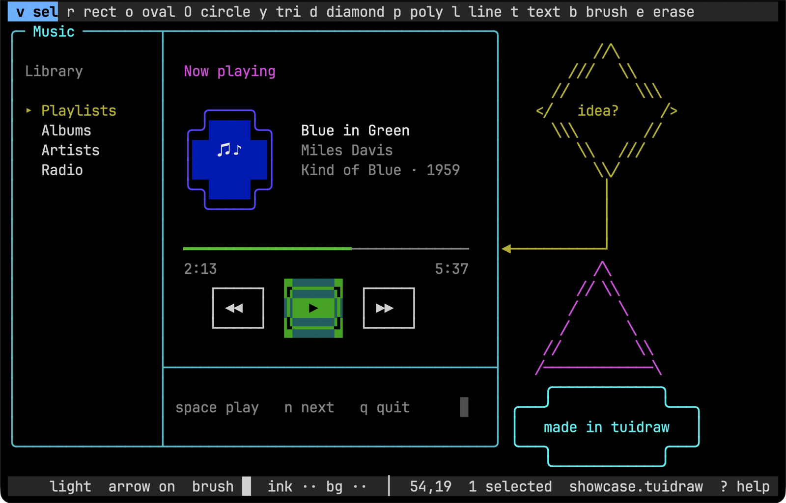

# tuidraw

An infinite-canvas editor for designing terminal UIs, and itself a terminal
app. Think Figma or Freeform, but every cell is one terminal character, so
what you draw is exactly what a TUI can show.



> [!NOTE]
> tuidraw is vibe coded: it was built by prompting Claude Opus 5.5 (low
> effort) in Claude Code, with a person steering, testing and reviewing.
> Expect rough edges, and read the code before relying on it.

## Install

```bash
go install github.com/raveensrk/tuidraw/cmd/tuidraw@latest
```

Run `tuidraw --help` for options. In the editor, press `?` for every key
binding.

## Documentation

[The tuidraw book](docs/README.md) covers the design, every contract and how
to build it.

## License

[MIT](LICENSE)
