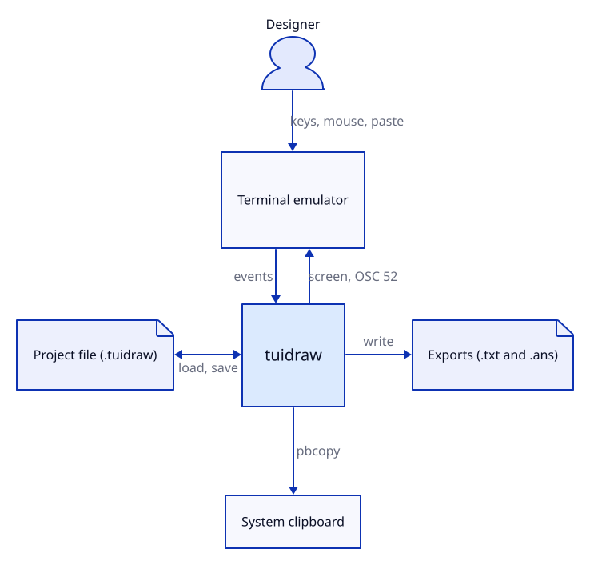
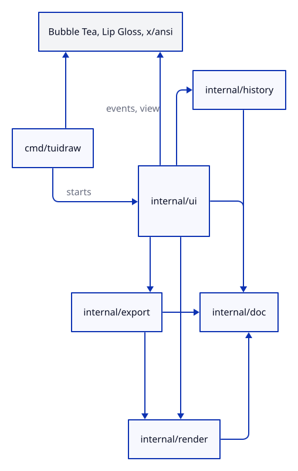

# Architecture

How tuidraw sits in its environment and how its packages divide the work.

## System context

tuidraw makes no network calls and reads no configuration.

## Packages

| Package | Responsibility | Imports from this repo | Chapter |
|---|---|---|---|
| [`cmd/tuidraw`](../cmd/tuidraw/main.go) | Parse arguments, print help, start the program | `ui` | [Interfaces](06-interfaces.md) |
| [`internal/ui`](../internal/ui) | Editor state, input, tools, view, help pager | `doc`, `render`, `history`, `export` | [Editor](05-editor.md), [UI](07-ui.md) |
| [`internal/render`](../internal/render/render.go) | Turn shapes into a grid of runes and colors; geometry | `doc` | [Rendering](04-rendering.md) |
| [`internal/export`](../internal/export/export.go) | Write a drawing as plain or ANSI text | `doc`, `render` | [Interfaces](06-interfaces.md) |
| [`internal/history`](../internal/history/history.go) | Undo and redo snapshots | `doc` | [Data](03-data.md) |
| [`internal/doc`](../internal/doc/doc.go) | Shape model, project file load and save | none | [Data](03-data.md) |

The rule behind the arrows: `doc` knows nothing about drawing, `render` knows nothing about input, and only `ui` knows about the terminal.

## Main loop

tuidraw follows the Elm architecture of its TUI framework.

| Step | Does |
|---|---|
| Update | Takes one terminal event, changes the editor state, may return a command such as quit or set-clipboard |
| View | Builds the whole screen as a styled string from the state, requesting the alternate screen and all-motion mouse reporting |

View renders only the visible window of the canvas; nothing is cached between frames.

## Tech stack

Versions live in [Build and run](08-build-run.md#dependencies).

| Technology | Used for | Why |
|---|---|---|
| Go | Language | One binary with no runtime; the choice itself is [an open question](13-open-questions.md#unknowns) |
| [Bubble Tea v2](https://github.com/charmbracelet/bubbletea) | Terminal event loop, alternate screen, mouse, paste, clipboard | Same open question |
| [Lip Gloss v2](https://github.com/charmbracelet/lipgloss) | Styled strings and width measurement | Companion to Bubble Tea |
| [x/ansi](https://github.com/charmbracelet/x) | Cutting styled strings to width | Width-safe truncation of styled text |
| Go standard library | JSON, regular expressions, file and process handling | No further dependency needed |

Previous: [Overview](01-overview.md) | Next: [Data](03-data.md)
