# Data

The shape model, the project file that stores it, and the snapshots that undo it.

Source: [`internal/doc/doc.go`](../internal/doc/doc.go), [`internal/history/history.go`](../internal/history/history.go).

## Model



A drawing is an ordered list of shapes, and index order is z-order: later shapes draw on top.
The grid is integer cells with X growing right and Y growing down; coordinates may be negative and have no limit.

A box is inclusive: `min` and `max` are both inside it, so a box from (0,0) to (3,2) covers 4 by 3 cells.

## Shape fields

One record type serves every kind, and each kind reads only its own fields.

| JSON key | Type | Read by | Meaning |
|---|---|---|---|
| `kind` | string | all | One of the kinds below |
| `box` | Box | rect, ellipse | Extent; omitted when all zero |
| `style` | string | rect, ellipse, polygon, line | Border style; anything unknown or empty draws as `light` |
| `points` | Point[] | polygon, line, text, stroke | Meaning depends on kind |
| `closed` | bool | polygon | The last vertex joins the first |
| `flip` | bool | line | Vertical leg first |
| `arrow` | bool | line | Arrowhead at the end |
| `fg` | string | all but group | Ink color of outline, text or brush; empty is the terminal default |
| `bg` | string | all but group | Background behind the shape's cells; empty is none |
| `fill` | bool | rect, ellipse, closed polygon | Opaque inside |
| `text` | string | text | May contain `\n` |
| `char` | string | stroke | First rune paints; empty paints `#` |
| `children` | Shape[] | group | Members in z-order |

False, empty and zero fields are omitted when saving.

## Kinds

| `kind` | `points` means | Notes |
|---|---|---|
| `rect` | unused | |
| `ellipse` | unused | A circle is an ellipse about twice as wide as tall |
| `polygon` | Vertices in order | Triangles and diamonds are closed polygons |
| `line` | Exactly two: start, end | Drawn as an elbow of two straight legs |
| `text` | Exactly one: top-left | |
| `stroke` | Every painted cell | |
| `group` | unused | Moves, styles and paints recurse into `children` |

## Enumerations

| Name | Values, in order |
|---|---|
| Style | `light`, `heavy`, `double`, `rounded`, `ascii` |
| Color | `black`, `red`, `green`, `yellow`, `blue`, `magenta`, `cyan`, `white`, `bright_black`, `bright_red`, `bright_green`, `bright_yellow`, `bright_blue`, `bright_magenta`, `bright_cyan`, `bright_white` |

A color's position is its ANSI number, 0 to 15; a name not on the list behaves like position -1, the default.

## Project file

The file is UTF-8 JSON, conventionally named `<name>.tuidraw`.

```json
{
  "version": 1,
  "shapes": [
    {
      "kind": "rect",
      "box": { "min": { "x": 0, "y": 0 }, "max": { "x": 3, "y": 2 } },
      "style": "light",
      "fg": "red",
      "fill": true
    },
    {
      "kind": "line",
      "points": [{ "x": 0, "y": 4 }, { "x": 3, "y": 6 }],
      "style": "light",
      "arrow": true
    },
    {
      "kind": "text",
      "points": [{ "x": 1, "y": 1 }],
      "text": "OK"
    }
  ]
}
```

A JSON Schema of what the editor itself writes:

```json
{
  "$schema": "https://json-schema.org/draft/2020-12/schema",
  "type": "object",
  "required": ["version", "shapes"],
  "properties": {
    "version": { "const": 1 },
    "shapes": { "type": "array", "items": { "$ref": "#/$defs/shape" } }
  },
  "$defs": {
    "point": {
      "type": "object",
      "required": ["x", "y"],
      "properties": { "x": { "type": "integer" }, "y": { "type": "integer" } }
    },
    "box": {
      "type": "object",
      "required": ["min", "max"],
      "properties": { "min": { "$ref": "#/$defs/point" }, "max": { "$ref": "#/$defs/point" } }
    },
    "shape": {
      "type": "object",
      "required": ["kind"],
      "properties": {
        "kind": { "enum": ["rect", "ellipse", "polygon", "line", "text", "stroke", "group"] },
        "box": { "$ref": "#/$defs/box" },
        "style": { "enum": ["light", "heavy", "double", "rounded", "ascii"] },
        "points": { "type": "array", "items": { "$ref": "#/$defs/point" } },
        "closed": { "type": "boolean" },
        "flip": { "type": "boolean" },
        "arrow": { "type": "boolean" },
        "fg": { "type": "string" },
        "bg": { "type": "string" },
        "fill": { "type": "boolean" },
        "text": { "type": "string" },
        "char": { "type": "string" },
        "children": { "type": "array", "items": { "$ref": "#/$defs/shape" } }
      }
    }
  }
}
```

### Saving

1. Set `version` to 1, and write an absent shape list as `[]`.
2. Encode with two-space indentation and a trailing newline, keys in the order of the field table.
3. Write to `<path>.tmp` with mode 0644, then rename over `<path>`.

An empty drawing saves as `{\n  "version": 1,\n  "shapes": []\n}\n`.
The current encoder writes each of the characters less-than, greater-than and ampersand as a six-character JSON unicode escape; any encoding that parses to the same JSON is compatible.
Saving overwrites an existing file without asking.

### Loading

| Input | Result |
|---|---|
| File missing | The editor starts an empty drawing that will save to that path |
| Other read error | The operating system's error |
| Invalid JSON | `<path>: <parse error>` |
| `version` above 1 | `<path>: format version <n> is newer than 1` |
| `version` missing or lower | Accepted |
| Unknown keys | Ignored |
| Fields added later, such as colors, absent from an old file | Zero values; the file loads |

### Versioning

The version number rises only for a change old readers cannot handle; adding an optional field does not raise it.
There are no migrations, because only version 1 exists.

## Invariants

The editor keeps these, but [Load does not check them](13-open-questions.md#known-issues).

- A line has exactly two points, a text has one, a stroke and polygon at least one.
- A group has at least one child.
- A rect or ellipse the editor draws is at least 2 by 2 cells.
- `box.min` is never right of or below `box.max`.
- Editor-placed polygons have at least two points, or three when closed, with no consecutive repeats.
- `fill` is set only on shapes that have an inside: rect, ellipse, closed polygon.

## Operations

| Operation | Rule |
|---|---|
| Span(a, b) | Box from two corners in any order |
| Has(p) | Point inside box, edges included |
| Union(a, b) | Smallest box covering both |
| Overlaps(a, b) | The boxes share at least one cell |
| Bounds, rect or ellipse | Its box |
| Bounds, text | At `points[0]`, as wide as the longest line in runes (at least 1), as tall as its line count |
| Bounds, group | Union of its children |
| Bounds, line, polygon, stroke | Box covering its points; a line's corner always lies inside it |
| Move(dx, dy) | Shifts box, points and children, whichever the shape has |
| Clone | Deep copy, sharing nothing |
| SetStyle | Sets style on rect, ellipse, polygon and line; recurses into groups; ignores others |
| Paint(fg, bg, fill) | Sets each given value; recurses into groups; fill applies only to shapes with an inside |

## Undo snapshots

History holds two stacks of whole-document deep copies: past and future.

| Operation | Effect |
|---|---|
| Push(current) | Copy onto past, dropping the oldest beyond 200 entries; clear future |
| Undo(current) | Fails when past is empty; else pop past as the result and copy current onto future |
| Redo(current) | Fails when future is empty; else pop future as the result and copy current onto past |
| Pop | Pop past with no redo entry; cancels an edit in progress |

Callers push the state before an edit, so one user action is one undo step.
History lives only in memory and is not stored in the project file.

Previous: [Architecture](02-architecture.md) | Next: [Rendering](04-rendering.md)
