# Rendering

How shapes become one rune, one ink and one background per cell.

Source: [`internal/render/render.go`](../internal/render/render.go).

## Pipeline



Draw takes a shape list and a window box, and returns a grid covering only that window.
Writes outside the window are dropped.

## Cell

| Field | Meaning |
|---|---|
| `mask` | OR of edge bits from every shape: N=1, E=2, S=4, W=8 |
| `style` | Style of the last edge written; it decides the whole cell's rune |
| `edgeZ`, `edgeFG` | Z and ink of the last edge written |
| `solid`, `solidZ`, `solidFG` | Opaque rune (0 for none), its z and ink |
| `bg` | Background color |

### Resolving a cell

1. If `solid` is set and `solidZ >= edgeZ`, the rune is `solid` and the ink `solidFG`.
2. Otherwise, a zero mask gives a space; any other mask gives its table rune with ink `edgeFG`.
3. The background is `bg`.

A cell outside the window reads as a space with no colors.

### Writing a cell

| Write | Effect |
|---|---|
| Edge | OR in the mask; set `style`, `edgeZ` and `edgeFG`; apply paint |
| Solid | Set `solid`, `solidZ` and `solidFG`; apply paint |
| Paint | Skipped for ellipse and polygon; otherwise, when the shape has a `bg` or `fill`, `bg` becomes the shape's `bg` |
| Wipe | Reset the whole cell, with `edgeZ` and `solidZ` at the shape's z; `bg` takes the shape's `bg` only if colored |

Painting skips curved and slanted outlines because a colored cell is a full square that would stick out past the edge.

## Rune tables

Each table is indexed by mask, 0 to 15.

| Style | Runes for mask 0 to 15 |
|---|---|
| `light` | `" │─└││┌├─┘─┴┐┤┬┼"` |
| `heavy` | `" ┃━┗┃┃┏┣━┛━┻┓┫┳╋"` |
| `double` | `" ║═╚║║╔╠═╝═╩╗╣╦╬"` |
| `rounded` | `" │─╰││╭├─╯─┴╮┤┬┼"` |
| `ascii` | `" \|-+\|\|++-+-+++++"` |

| Arrowhead traveling | Unicode | With `ascii` style |
|---|---|---|
| North | `▲` | `^` |
| East | `▶` | `>` |
| South | `▼` | `v` |
| West | `◀` | `<` |

## Z-order

Z starts at 0 and each top-level shape takes the next number.
A group's first child uses the group's z, and each later child the next number after the previous child's last.
A non-group shape fully outside the window is skipped but still consumes its number.

## Shapes

### Rect

For each column of the box, the top and bottom rows get W when not the leftmost column and E when not the rightmost.
When the box is taller than one row, the two corner columns also get S on top and N on the bottom.
Rows between get N and S at both side columns.

### Line

The path has two legs: horizontal then vertical, or vertical then horizontal when flipped.

```text
a───┐        a
    │        │
    b        └───b   (flip)
```

| Case | Drawing |
|---|---|
| One-cell path | An edge of E and W at that cell |
| Otherwise | For each consecutive pair, the first cell gets the direction to the second and the second the opposite |
| `arrow`, two cells or more | The last cell gets a solid arrowhead for its final direction of travel |

### Text

Split on `\n`; each rune is a solid at its row and column, one cell per rune whatever its display width.
A space is a solid too, so it hides an edge below it.
Empty text draws nothing.

### Stroke

Each point gets a solid of the first rune of `char`, or `#` when empty.

### Group

Children draw in order, as under [Z-order](#z-order).

### Ellipse

A `light` ellipse draws with the `rounded` table, because square corners look like boxes.

The outline is a closed path of cells stepping only horizontally or vertically:

```text
cx, cy = centre of box;  a, r = half width, half height
reach(p) = ((p.x-cx)/max(a,0.5))^2 + ((p.y-cy)/max(r,0.5))^2
outer(c1, c2) = c2 if reach(c2) > reach(c1), else c1

steps = trunc(8*(a+r)) + 8
for i in 0..steps-1:
    t = 2*pi*i/steps
    p = (round(cx + a*cos t), round(cy + r*sin t))      # halves round away from zero
    if p equals the last cell: skip
    if p differs from the last cell in both axes:
        append outer((p.x, last.y), (last.x, p.y))
    append p

while the path has more than one cell and its end equals its start: drop the end
if end and start differ in both axes: append outer((start.x, end.y), (end.x, start.y))

repeat until nothing changes, while the path has more than 2 cells:
    find the first i, wrapping around, where path[i-1] == path[i+1]
    remove path[i] and path[i+1]
```

The last step removes out-and-back spikes that would draw stubs.

Each consecutive pair, wrapping around and skipping equal cells, then gets edges as for a line.
A path of fewer than two cells draws E and W at its cell.

### Polygon

Sides join consecutive vertices, plus last to first when closed with at least three vertices.

| Side | Drawing |
|---|---|
| Both ends equal | Nothing |
| Horizontal or vertical | Edges as for a line, so it joins other borders |
| Slanted | Every cell of the [Bresenham line](#bresenham-line) gets one solid chosen by slope |

Slope is judged as seen on screen, with cells twice as tall as wide:

```text
deg = atan2(|dy*2|, |dx|) in degrees
deg < 22.5   -> table rune for E|W
deg > 67.5   -> table rune for N|S
ascii style  -> "\" if (dx>0) == (dy>0), else "/"
other styles -> "╲" if (dx>0) == (dy>0), else "╱"
```

Then each vertex is reshaped when both its sides slant; open polygons skip their two end vertices.
Let (ax, ay) be the sign of the offset from the vertex to its previous neighbor, and (bx, by) to its next.
If any of the four is zero, the vertex is left alone.

| Condition, first match | Solids |
|---|---|
| `ay>0`, `by>0`, `ax≠bx` (top point) | Up diagonal at the vertex, down diagonal one cell right |
| `ay<0`, `by<0`, `ax≠bx` (bottom point) | Down diagonal at the vertex, up diagonal one cell right |
| `ax>0`, `bx>0`, `ay≠by` (left point) | `<` at the vertex |
| `ax<0`, `bx<0`, `ay≠by` (right point) | `>` at the vertex |

The up diagonal is `╱` and the down diagonal `╲`, or `/` and `\` for `ascii`.
The top and bottom points can [write one cell past the polygon's bounds](13-open-questions.md#known-issues).

### Bresenham line

```text
dx = |b.x-a.x|;  dy = -|b.y-a.y|
sx = -1 if a.x > b.x else 1;  sy = -1 if a.y > b.y else 1
out = [a];  e = dx + dy
while a != b:
    e2 = 2*e
    if e2 >= dy: e += dy; a.x += sx
    if e2 <= dx: e += dx; a.y += sy
    append a
```

## Fill

A filled shape is wiped before its outline draws, so it hides everything below.

| Step | Cells | Background |
|---|---|---|
| 1 | Every cell of its bounds where [Inside](#inside) holds | The shape's `bg` |
| 2, ellipse | Every cell of the outline path | None |
| 2, polygon | Every cell of the Bresenham line of every side, including last to first | None |

A rect's border cells count as inside, so they keep the background.

## Inside

| Kind | Inside when |
|---|---|
| Rect, text | The point is within its bounds |
| Ellipse | With a and r as above, `((x-cx)/max(a,0.5))^2 + ((y-cy)/max(r,0.5))^2 <= 1` |
| Closed polygon | Even-odd ray test below |
| Group | Inside any child |
| Line, stroke, open polygon | Never |

```text
in = false
for each side from vertex a to vertex b:
    if (a.y > y) == (b.y > y): continue
    cx = a.x + (y-a.y)/(b.y-a.y) * (b.x-a.x)
    if x < cx: in = not in
```

## Hit

A shape is hit at a cell when the cell is within its bounds and drawing that shape alone there gives a non-space rune.

Previous: [Data](03-data.md) | Next: [Editor](05-editor.md)
