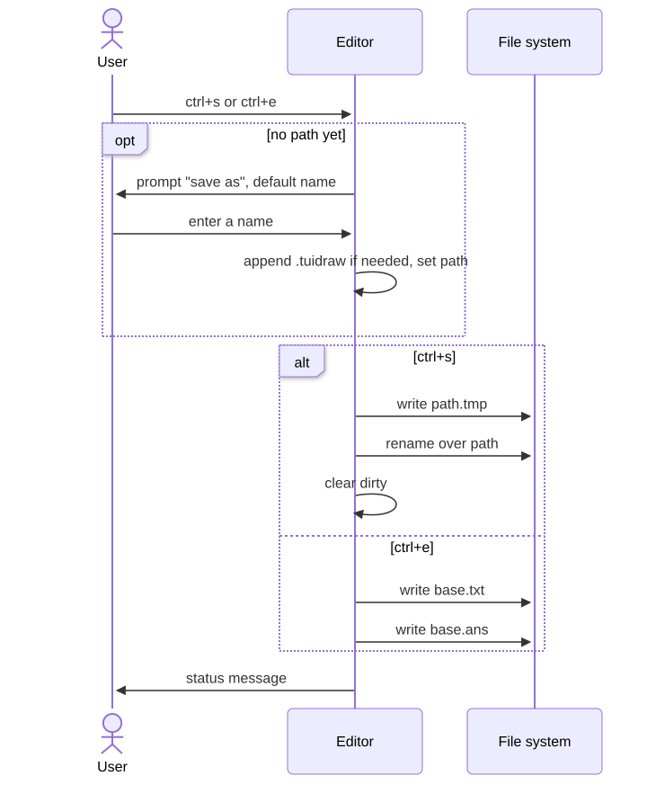
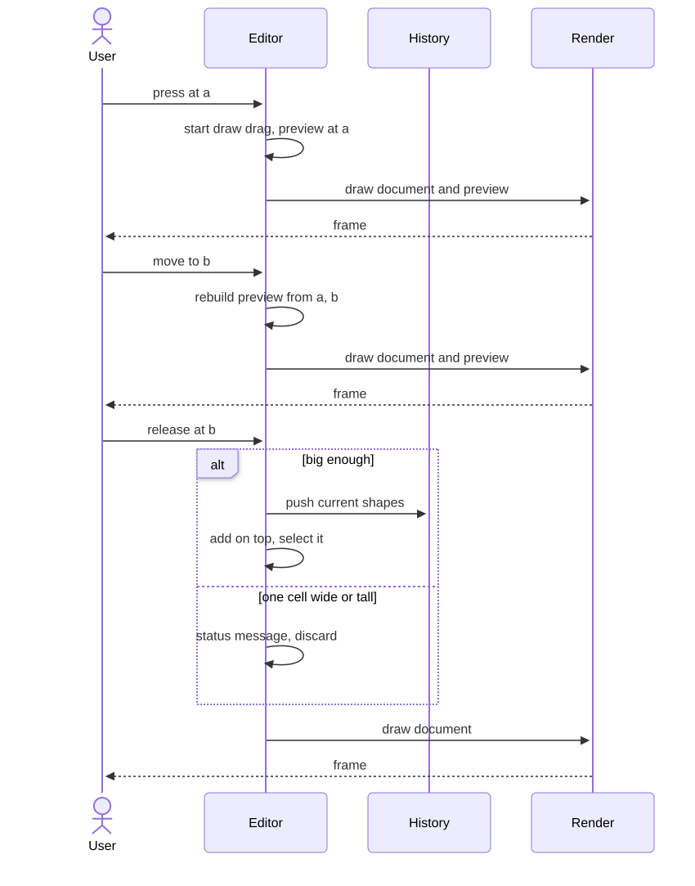

# Editor

The editor's state and how every input changes it.

Source: [`internal/ui/model.go`](../internal/ui/model.go), [`internal/ui/pointer.go`](../internal/ui/pointer.go).
The keys themselves are listed in [Interfaces](06-interfaces.md#key-bindings).

## State

| State | Start value | Meaning |
|---|---|---|
| Shapes, undo history | From file, or empty | The document |
| Selection | Empty | Sorted, unique top-level shape indices |
| Path, dirty | Argument, false | Save target; unsaved changes exist |
| Width, height | From the terminal | Screen size |
| View | (0,0) | World cell at the canvas's top-left |
| Cursor | (0,0) | World cell of the pointer, shared by mouse and keyboard |
| Tool | Select | Active tool |
| Style, arrow, brush | `light`, on, `█` | Defaults for new shapes |
| Ink, paper, fill | Default, default, off | Colors and fill for new shapes |
| Modes | None | Drag, text edit, polygon in progress, prompt, help, palette, brush character |
| Internal clipboard | Empty | Deep copies of shapes |
| Quit armed | False | The first `q` with unsaved changes was pressed |
| Last click | None | Time and cell, for double-click |

| Constant | Value |
|---|---|
| Double-click window | Under 400 ms at the same cell |
| Wheel step | 3 cells |
| Duplicate offset | 2 right, 1 down |
| Default size from a plain click | 12 by 5 |
| Default save name | `drawing.tuidraw` |

The canvas has `max(height-2, 1)` rows.
A screen cell (x, y) is the world cell (view.x+x, view.y+y-1).

## Events

| Event | Handling |
|---|---|
| Window resize | Store the size, and pass it to the pager if open |
| Key press | [Key routing](#key-routing) |
| Bracketed paste | [Paste](#clipboard), in every mode |
| Mouse | [Mouse routing](#mouse-routing), ignored while help or a prompt is open |

## Key routing

The first matching mode takes the key.

| Mode | Behavior |
|---|---|
| Help | [Pager](07-ui.md#help-pager) takes the key |
| Prompt | Enter submits, esc cancels with "cancelled", backspace deletes, `ctrl+u` clears, other text appends; a blank value after trimming does nothing |
| Text edit | [Text editing](#text-editing) |
| Palette | `0` picks default, a palette key picks its color, anything else cancels with "cancelled" |
| Brush character | The next key's first text rune becomes the brush; esc or a key with no text just leaves the mode |
| Canvas | Disarm quit unless the key is `q`; tool keys first, then the [canvas keys](06-interfaces.md#canvas) |

Choosing a tool commits any text edit, finishes any polygon as open, and drops any drag without undoing it.

## Mouse routing

| Event | Behavior |
|---|---|
| Wheel | Up and left subtract the wheel step from view y and x, down and right add it; shift swaps the axes; cursor unchanged |
| Press, palette open, status row | [Picks a swatch](07-ui.md#palette-row) and stops |
| Press, palette open, elsewhere | Closes the palette and carries on |
| Press, toolbar row | Picks the tool under the column, if any |
| Press, status row | Ignored |
| Press, canvas, right or middle | Moves the cursor and starts a pan |
| Press, canvas, left | Moves the cursor and presses the pointer; shift, ctrl or alt make it a toggle |
| Motion, panning | View becomes the start view minus the screen offset; cursor unchanged |
| Motion, otherwise | Moves the cursor, updates any polygon's loose end, and moves any drag |
| Release, panning | Ends the pan |
| Release, otherwise | Moves the cursor and releases any drag |

Motion arrives even with no button held, so the cursor follows the mouse.

## Keyboard pointer

Arrows move the cursor one cell, scroll the view by the minimum that keeps it on the canvas, with no margin, update any polygon's loose end, and move any drag.
The origin key sets the view to (0,0) and the cursor to (trunc(width/2), trunc(canvas rows/2)).
Enter or space presses the pointer at the cursor when no drag is running, and releases it otherwise.
A keyboard press counts towards double-click just like a mouse press.

## Pointer drag

The same three steps serve mouse and keyboard.
Release first applies a final move if the pointer changed cell.

### Pressing, by tool

| Tool | On press |
|---|---|
| Select | [Select press](#select-press) |
| Rect, oval, circle, triangle, diamond | Start a draw with a preview of the [box shape](#box-shapes) at that single cell |
| Line | Start a draw with a preview line of two equal points, using the default style and arrow |
| Polygon | [Polygon placing](#polygon-placing) |
| Text | Commit any edit; a hit on a text shape edits it, otherwise start a new text shape here |
| Brush | Start a draw with a one-cell stroke of the brush character |
| Eraser | Start an erase and erase this cell |

New shapes take the current ink, paper and fill, with fill only where the shape has an inside.

### Moving, by drag

| Drag | On move |
|---|---|
| Draw, box tool | Rebuild the preview from the start and pointer |
| Draw, line | Until decided, flip is `dy > dx` measured from the start, and it is decided once `dx ≠ dy`; the end follows the pointer |
| Draw, brush | Append the Bresenham cells from the last point, without repeating it |
| Move | Push undo on the first move only; shift every selected shape by the pointer's change |
| Handle | Push undo on the first move only, even if the resize is then ignored; [resize](#handles) |
| Erase | Erase each Bresenham cell from the old cell, excluded, to the new one |
| Marquee | Only tracks the pointer |

### Releasing, by drag

| Drag | On release |
|---|---|
| Marquee | Add every shape whose bounds overlap the box from start to release; it only adds, whether or not the press toggled |
| Draw, box tool, released at its start cell, even after moving away | Use a shape built from the start to 11 right and 4 down |
| Draw, box tool, 1 cell wide or tall | Discard, status "shape needs at least 2x2 cells" |
| Draw, line released at its start | Discard silently |
| Draw, otherwise | Push undo, add on top, select only it; the tool stays active |
| Move, handle, erase | Nothing more |

### Cancelling

Esc takes the first that applies: finish a polygon as open; cancel a drag; clear the selection and status.
Cancelling a drag that already pushed undo restores that snapshot, leaving no redo step, and sets status "cancelled".
A cancelled marquee keeps whatever selection is left.

## Select press

1. Commit any text edit.
2. A handle at the cell starts a handle drag.
3. No shape at the cell: clear the selection unless toggling, and start a marquee.
4. Toggling: flip that shape's selection, with no drag.
5. A double-click on a text shape edits it.
6. Otherwise select the shape alone unless already selected, and start a move.

The shape at a cell is the topmost one [hit](04-rendering.md#hit); failing that, the topmost one the cell is [inside](04-rendering.md#inside).
Drawn cells win, so a big box never hides what sits in it, while clicking its empty inside still selects it.

## Handles

Only a lone selected shape has handles.

| Kind | Handles |
|---|---|
| Rect, ellipse | Corners clockwise from top-left |
| Line, polygon | Each of its points |
| Others | None |

Dragging a line or polygon handle moves that point.
Dragging a box corner keeps the opposite corner fixed, and is ignored while the pointer shares its row or column, so the box stays at least 2 by 2.
A corner dragged past the opposite one flips the box, and the drag follows whichever corner is under the pointer.
Ellipse resizing is free, so circles need not stay round.

## Box shapes

Built from the drag start a and pointer b.

| Tool | Shape |
|---|---|
| Rect | Rect of Span(a, b) |
| Oval | Ellipse of Span(a, b) |
| Circle | Ellipse with `h = max(abs(b.y-a.y)+1, trunc((abs(b.x-a.x)+2)/2))`, `w = 2h-1`, of Span(a, (a.x+sx*(w-1), a.y+sy*(h-1))), where sx and sy are -1 when b is left of or above a, else 1 |
| Triangle | Closed polygon in Span(a, b): (midX, minY), (maxX, maxY), (minX, maxY) |
| Diamond | Closed polygon in Span(a, b): (midX, minY), (maxX, midY), (midX, maxY), (minX, midY) |

The midpoints use integer division that truncates towards zero.

## Polygon placing

| Step | Rule |
|---|---|
| First press | Points become [p, p], the second being the loose end following the pointer |
| Later press at the first point, with at least 3 placed, not counting the loose end | Finish closed |
| Later press, double-click | Finish open |
| Later press, otherwise | Replace the loose end with p and add a new loose end |
| Finish | Drop the loose end and consecutive repeats; when closed also a last point equal to the first |
| Too few | Under 2 points, or under 3 when closed: discard silently |
| Enough | Push undo, add on top, select it |

## Text editing

The shape being edited is drawn in place of the original, or on top when new, and the caret is a rune offset.
Editing starts with the caret at the end, the shape selected.

| Key | Effect |
|---|---|
| Esc, `ctrl+s` | Commit |
| Enter | Insert a newline |
| Backspace, delete | Remove the rune before, after the caret |
| Left, right | Move the caret, stopping at the ends |
| Home or `ctrl+a`, end or `ctrl+e` | Move to the start, end of the current line |
| Any other key with text | Insert it |
| Any other key, such as up and down | Nothing |

| Commit case | Result |
|---|---|
| New, blank after trimming | Discarded |
| New, with text | Push undo, add on top, select it |
| Existing, blank | Push undo, delete it, clear the selection |
| Existing, changed | Push undo, replace it |
| Existing, unchanged | Nothing |

The caret's cell is the shape's top-left, plus runes since the last newline across, plus newlines before it down.

## Eraser

At a cell, the topmost hit shape is affected and clearing a shape's empty inside does nothing.
The first effect in a drag pushes undo, and any effect clears the selection.
A stroke loses every point at that cell, and is removed when none remain; any other shape, group included, is removed whole.

## Selection commands

All are no-ops with nothing selected, unless noted, and each pushes one undo step when it acts.

| Command | Effect |
|---|---|
| Nudge | Move the selection one cell |
| Delete | Remove the selection; status "deleted n" |
| Select all | Select every top-level shape, with no undo step |
| Duplicate | Insert copies offset by the duplicate offset |
| Group, two or more selected | Replace them with one group holding them in z-order, placed where the topmost was, and select it |
| Group, one group selected | Replace it with its children in place, and select them |
| Forward | From the top down, swap each selected shape with the one above unless that is selected too or none exists |
| Backward | From the bottom up, the same downward |
| To front, to back | Move the selection to the top, bottom, keeping its order |

Insert means: push undo, move the new shapes by the offset, add on top, select only them, status "added n".
Reordering pushes undo even if nothing moves.

## Style commands

| Command | Default changed | Selection changed |
|---|---|---|
| Border style | Always | SetStyle on each selected shape |
| Pick ink or paper | Always | Paint on each selected shape |
| Fill toggle | Only with no selection | Fill set on all to the opposite of the first selected shape's `fill` |
| Arrow toggle | Only with no top-level line selected | Each selected line flips its own `arrow` |
| Flip | Never | Each selected line flips its own `flip`; nothing without one |
| Brush character | Always | Never |

## Clipboard

| Action | Behavior |
|---|---|
| Copy | Deep-copy the selection to the internal clipboard, status "copied n", and send its [text export](06-interfaces.md#text-export) to the [system clipboard](06-interfaces.md#system-clipboard) |
| Cut | Copy, then delete |
| Paste key | Insert the internal clipboard with its bounds' top-left at the cursor; nothing when empty |
| Bracketed paste | See below |

Bracketed paste converts `\r\n` to `\n`, then takes the first that applies:

1. In a text edit, insert at the caret.
2. If it equals the internal clipboard's text export, ignoring trailing newlines, paste the shapes.
3. Trim trailing newlines; empty text does nothing.
4. Insert, with no offset, a new text shape at the cursor with the current colors.

## Undo and redo

Both clear the selection and mark the file dirty, or set status "nothing to undo" or "nothing to redo".
Every undo push also marks the file dirty, and only a successful save clears it.
Saving neither clears history nor records a clean point.

## Saving, exporting, quitting

| Action | Behavior |
|---|---|
| No path yet | Prompt labeled `save as:` and a space, prefilled with the default save name |
| Name given at the prompt | Append `.tuidraw` unless already there; it becomes the path, and the save or export carries on |
| Save | [Project file save](03-data.md#saving); clear dirty, status "saved path"; on failure status "save failed: error" and stay dirty |
| Export | Remove the file name's last dot and what follows, if any, add `.txt` and `.ans`, and write both; dirty unchanged; on failure status "export failed: error" |
| `q` | Quits when clean or armed; otherwise arms and warns |
| `ctrl+q` | Quits at once, discarding changes |

## Drawing a shape, end to end

## Starting up

| File argument | Start state | Status |
|---|---|---|
| None | Empty, no path | `new drawing - ? for help` |
| Missing file | Empty, that path | `new file <path>` |
| Readable project | Its shapes | `opened <path> (<n> shapes)` |
| Any other load error | The program exits 1 | |

Previous: [Rendering](04-rendering.md) | Next: [Interfaces](06-interfaces.md)
