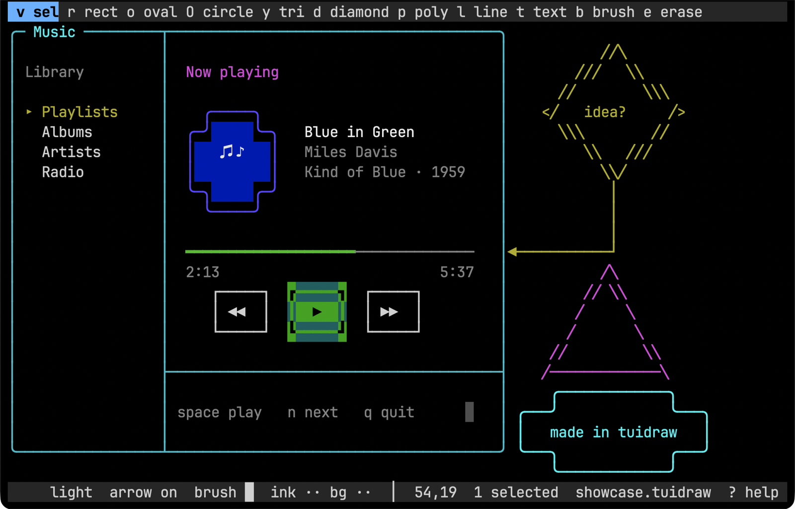

# UI

What the screen looks like and how each part is laid out.

Source: [`internal/ui/view.go`](../internal/ui/view.go), [`internal/ui/help.go`](../internal/ui/help.go).

## Screens





The editor always uses the alternate screen and all-motion mouse reporting.
Before the first window size arrives, the screen is empty.

## Editor layout

| Row | Content |
|---|---|
| 0 | Toolbar |
| 1 to height-2 | Canvas, full width |
| Last | Status row, or palette row while picking a color |

Toolbar and status rows are padded to the width with their bar style, or cut to it.

### Toolbar

Each tool in [key table](06-interfaces.md#tools) order is the text `" <key> <label>"`, with its clickable span exactly as wide.
The active tool uses the active style.

### Status row

```text
 <message><gap>  <style>  arrow <on|off>  brush <char>  ink <swatch> bg <swatch>[ filled]  │  <x>,<y>[  <n> selected]  <file>[*]  ? help
```

| Part | Rule |
|---|---|
| Message | Status text, or while prompting the label, value and `█` |
| Gap | Fills the row, at least two spaces |
| Long message | Cut to end in `…`; dropped entirely if under 8 cells of room |
| File | Base name of the path, or `untitled` |
| `*` | Unsaved changes |
| Swatch | `██` in the color on the bar background, or `··` for default |

### Palette row

```text
 <ink|paper>:  0 none  1██ 2██ ... h██   key or click, esc cancels
```

Each of the 16 entries is four cells: space, key, two swatch cells, starting right after `" <which>:  0 none "`.
A click on an entry picks it, and a click on `0 none` or the space after it picks default; any other column on the row does nothing.

## Canvas painting

Each cell gets a rune and colors from [rendering](04-rendering.md) of the document, plus any shape being drawn or edited on top, then a paint class.
The highest applicable class wins.

| Priority | Class | Applies to | Foreground, background |
|---|---|---|---|
| 1 | Caret | Caret cell while editing | Black, ink grey |
| 1 | Cursor | Pointer cell when not editing | Ink grey, cursor grey |
| 1 | Handle | Each [handle](05-editor.md#handles), unless the cursor is there | Black, accent |
| 2 | Marquee | Marquee's edge cells; a blank there shows `·` | Accent, none |
| 3 | Preview | Non-blank cells of the shape being drawn or edited | Warm, none |
| 4 | Picked | Non-blank cells of selected shapes | Accent, selection tint |
| 5 | Plain | Everything else | Ink grey, none |

Shape colors then apply over the class.

| Shape color | Rule |
|---|---|
| Ink | Replaces the foreground, except for caret, cursor and handle |
| Background | Replaces the background |
| Selection tint | Always wins on picked cells |

Shape colors are the terminal's own numbered ANSI colors, so the editor shows what the `.ans` export will.

## Interface colors

All are dark-theme values and need not match exactly.

| Name | Value | Use |
|---|---|---|
| Accent | `#5fafff` | Selection, handles, active tool |
| Warm | `#ffaf5f` | Preview, current search match |
| Dim | `#6c6c6c` | Other search matches |
| Bar | `#262626` | Toolbar and status background |
| Ink grey | `#d0d0d0` | Default text |
| Black | `#000000` | Text on bright backgrounds |
| Cursor grey | `#4e4e4e` | Cursor cell |
| Selection tint | `#1c3a5e` | Selected cells |

The active tool is bold, black on accent.

## Status messages

Those not given with their behavior in [Editor](05-editor.md).

| When | Message |
|---|---|
| Tool chosen | The tool's label |
| Style chosen | `style <name>` |
| Color picked | `<ink\|paper> <name or default>` |
| Fill or arrow toggled | `fill <true\|false>`, `arrow <true\|false>` |
| Brush | `press a key for the brush character`, then `brush <char>` |
| Quit armed | `unsaved changes - q again to quit, ctrl+s to save` |
| Undo, redo | `undo`, `redo` |
| Group, ungroup | `grouped`, `ungrouped` |
| Text edit | `typing - esc to finish`, `editing - esc to finish`; cleared on commit |
| Polygon | `click to add points - click the first to close, double-click or esc to finish`; cleared on finish |
| Exported | `exported <base>.txt and .ans` |

## Help pager

The `?` key opens a full-screen page, moving like `less`.
All rows but the last show text; the last is a footer.

The page states what the app is for and where data lives, then every binding grouped as tools, pointer, selection, style, color, text editing and file, then what colors and symbols mean, how prompts behave, and the page's own keys.

| Key | Action |
|---|---|
| `j`, down | Down one line |
| `k`, up | Up one line |
| `space`, `f`, page down | Down one page |
| `b`, page up | Up one page |
| `d`, `u` | Down, up half a page |
| `g` or home, `G` or end | Top, bottom |
| `/` | Start a search |
| `n`, `N` | Next, previous match, wrapping |
| `esc` | Clear an active search, otherwise leave |
| `q` | Leave |

Scrolling stops at the top, and at the last full page.

| Search input key | Action |
|---|---|
| Enter | Run the search |
| Esc | Abandon the input, keeping any earlier search |
| Backspace | Delete a rune |
| Other text | Append |

| Search rule | Behavior |
|---|---|
| Pattern | Literal text |
| Case | Ignored unless the pattern has a capital |
| Empty pattern | Clears the search |
| First match | First matching line at or below the top line, else the first overall |
| Scrolling | If the current line is off screen, it moves to the top, within scrolling limits |
| Highlight | Every match shows black on dim; those on the current match's line black on warm |

Each footer starts with one space, on the bar background.

| Footer | When |
|---|---|
| `help - q to leave, / to search` | Default |
| `/<input>█` | Typing a search |
| `match <i> of <n>` | Active search with matches, counting matching lines |
| `no match` | Active search without |

Previous: [Interfaces](06-interfaces.md) | Next: [Build and run](08-build-run.md)
